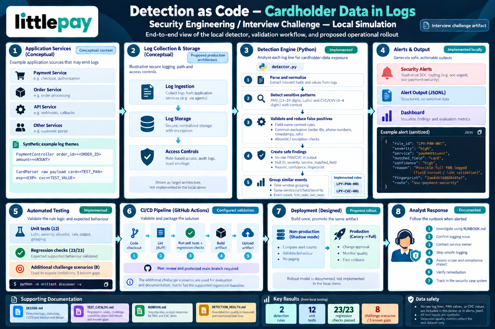

# Detection as Code — Cardholder Data in Logs

Littlepay Security Engineer challenge, Option A.

A small Python detector that flags payment card data (PAN and CVC) that's
been accidentally logged by an application service — without ever repeating
the sensitive value itself in its own output.

- [Run it and dashboard](#run-it-and-dashboard)
- [Architecture overview](#architecture-overview)
- [Project layout](#project-layout)
- [How it works](#how-it-works)
- [Explore the project](#explore-the-project)
- [How this answers Littlepay's four tasks](#how-this-answers-littlepays-four-tasks)

## Run it and dashboard

Python 3.10+, standard library only, nothing to install.

```bash
python -m unittest discover -v
python run_lab.py
```

`run_lab.py` runs all 31 labelled fixtures and writes a dashboard to
`lab_output/demo_dashboard.html` — **open it in a browser**. It's the
fastest way to see the actual results: true/false positives and negatives
per rule, the 5 known gaps, and precision/recall, generated fresh from the
code each run rather than hand-written numbers in a doc.

## Architecture overview



Each box is labeled **Implemented**, **Conceptual**, **Proposed**, or
**Documented**, distinguishing what's actually running in this repo from
what's designed for a production Littlepay deployment.

## Project layout

```
.
├── detector.py              # detection logic
├── test_detector.py         # 12 unit tests
├── run_lab.py                # runs fixtures, builds the dashboard
├── rule_metadata.json
├── config.json                # allowlist / exception config
├── assets/
│   └── architecture-overview.png
├── fixtures/
│   ├── lab_cases.json          # 23-case release gate
│   ├── challenge_cases.json    # 8 harder, diagnostic cases
│   └── sample_application.log
├── docs/
│   ├── DESIGN.md               # Tasks 2–3
│   ├── DETECTION_HEALTH.md     # Task 4
│   ├── RUNBOOK.md
│   └── TEST_CATALOG.md
├── lab_output/                 # generated by run_lab.py
└── .github/workflows/ci.yml
```

## How it works

Two rules:

- **`LPY-PAN-001`** — finds candidate card numbers (13–19 digits), then
  confirms them with a Luhn check or an explicit field name like `card` /
  `pan`. Known-safe fields (`order_id`, `phone`, `ref`, etc.) are excluded
  up front.
- **`LPY-CVC-001`** — finds security codes by field name only (`cvc`,
  `cvv`, `cvv2`...), since a CVC has no checksum to validate against.
  Always Critical.

Alerts never contain the raw PAN, CVC, or source log line — just a rule ID,
severity, matched field, and a one-way fingerprint.

**Precision and recall.** The 12 unit tests and the original 23 labelled
fixtures all pass — that's the release gate. I also added 8 harder
fixtures outside the gate; 5 of them expose real gaps in the current logic:

- a PAN missed when it's logged under `ref`
- a dot-separated PAN the regex doesn't catch
- a couple of field-name false positives

Across all 31 cases: PAN sits at 90.9% precision / 83.3% recall, CVC at
80% / 80%. Full breakdown in `docs/TEST_CATALOG.md`.

## Explore the project

| File | What's there |
|---|---|
| [`detector.py`](detector.py) | The PAN/CVC detection logic |
| [`test_detector.py`](test_detector.py) | The 12 unit tests |
| [`fixtures/`](fixtures/) | The 23-case release gate and the 8-case challenge set |
| [`lab_output/demo_dashboard.html`](lab_output/demo_dashboard.html) | Visual results, generated by `run_lab.py` |
| [`docs/DESIGN.md`](docs/DESIGN.md) | Rule metadata, alert design, CI/CD rollout |
| [`docs/DETECTION_HEALTH.md`](docs/DETECTION_HEALTH.md) | Keeping detections healthy over time |
| [`docs/RUNBOOK.md`](docs/RUNBOOK.md) | What an analyst does when this fires |
| [`docs/TEST_CATALOG.md`](docs/TEST_CATALOG.md) | Why each fixture exists, full precision/recall breakdown |

## How this answers Littlepay's four tasks

| Task | What it asked for | What I did |
|---|---|---|
| **Task 1** — detection + tests | Pick one target; deliver rule logic and a tested TP/FP suite | Two rules in `detector.py`: PAN (Luhn + field context) and CVC (field name only). 12 unit tests, a 23-case release gate, and an 8-case challenge set exposing 5 known gaps |
| **Task 2** — production-grade | Rule metadata; FP handling as testable code; actionable alert output | Metadata in `rule_metadata.json`; a tested allowlist in `config.json`; sanitized, deduplicated alerts — see `docs/DESIGN.md` |
| **Task 3** — ship it like software | A CI/CD pipeline mapped to how Littlepay already ships code | A real GitHub Actions pipeline (`.github/workflows/ci.yml`) plus the full rollout/rollback design in `docs/DESIGN.md` |
| **Task 4** — keep detections healthy | How to measure and maintain quality across many services | Metrics, ownership, and review rhythm in `docs/DETECTION_HEALTH.md` |
